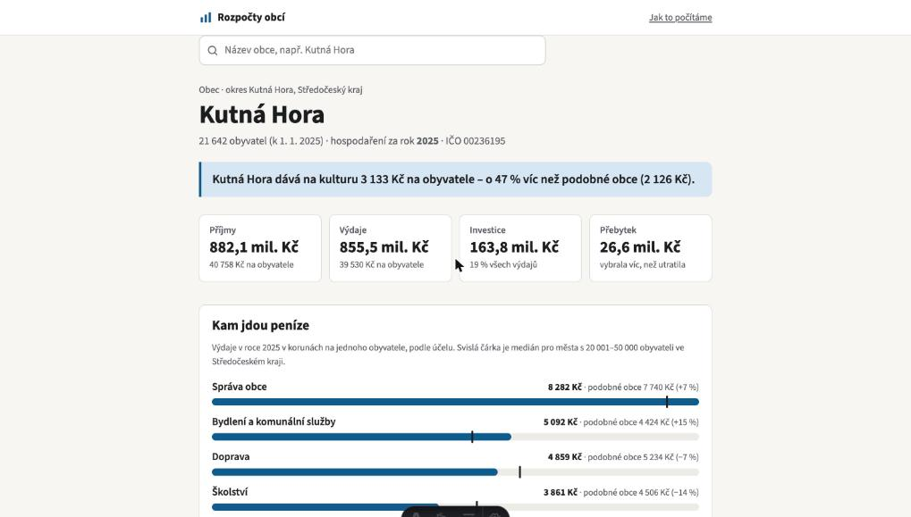
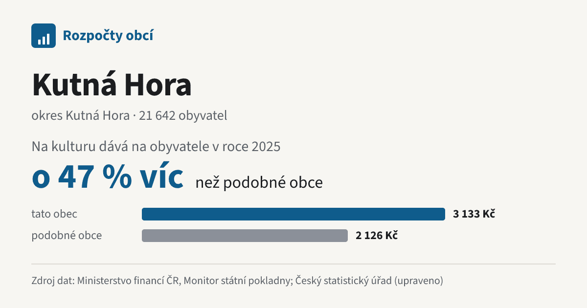

# Rozpočty obcí

**Kolik vybrala a za co utratila každá z 6 254 obcí v Česku: přepočteno na obyvatele a porovnáno s podobně velkými obcemi.**

🌐 **Web:** https://adam-broz.github.io/rozpocty-obci/



## Co web ukazuje

- **Hlavní čísla obce:** příjmy, výdaje, investice a přebytek nebo schodek za poslední uzavřený rok.
- **Kam jdou peníze:** 11 srozumitelných oblastí (doprava, školství, kultura, sport, bydlení
  a komunální služby, životní prostředí, sociální služby, zdravotnictví, bezpečnost, správa obce,
  ostatní). Vše v Kč na obyvatele.
- **Srovnání s podobnými obcemi:** medián obcí stejné velikostní kategorie ve stejném kraji
  („o 47 % víc než podobné obce“).
- **Odkud peníze přicházejí:** daně, dotace, nedaňové příjmy, prodej majetku.
- **Vývoj v čase** za 5 let a **plán vs. skutečnost** (schválený rozpočet, rozpočet po změnách, skutečnost).
- **Shrnutí „Ve zkratce“** běžnou češtinou, **vysvětlivky „Co to znamená?“** u každé sekce a **slovníček pojmů**.
- **Přehled po krajích:** tabulka všech obcí kraje s filtrem a řazením.
- **Obrázek ke sdílení** pro každou obec, s jedním zajímavým číslem:

  

## Jak to funguje

```
Monitor státní pokladny (MF ČR)        ČSÚ
  FIN 2-12 M + číselníky          počet obyvatel obcí
            │                            │
            └────────────┬───────────────┘
                         ▼
   pipeline/  (Python 3.12, uv, DuckDB)
   stažení s cache → očištění → konsolidace → kategorie → mediány skupin
                         ▼
   web/public/data/  meta.json · index.json · obce/{kód obce}.json
                         ▼
   web/  (Astro, statické stránky, grafy v SVG bez knihoven, OG obrázky přes satori)
                         ▼
   GitHub Pages: jednou měsíčně ho přegeneruje GitHub Action
```

Podrobná metodika je na webu v sekci „Jak to počítáme“, všechna rozhodnutí
jsou v [DECISIONS.md](DECISIONS.md). Nejdůležitější body:

- Zobrazujeme **skutečnost za uzavřené roky**, ne plán.
- **Převody mezi vlastními účty obce** (konsolidační položky jako 4134/5345) se nepočítají,
  jinak by se peníze počítaly dvakrát. Čísla pak sedí s „konsolidovanými“ příjmy a výdaji
  na portálu Monitor. Ověřeno na Praze, Kutné Hoře a Vysoké Lhotě, viz [VALIDATION.md](VALIDATION.md).
- Srovnání používá **medián ostatních obcí** stejné velikosti v kraji, ne průměr.

## Spuštění lokálně

Potřebujete [uv](https://docs.astral.sh/uv/) a Node.js 22 (pro web stačí i 20).

```bash
uv run python -m pipeline
```

První běh stáhne asi 700 MB a trvá několik minut. Další běhy použijí cache v `data/raw/`
a doběhnou za pár sekund.

```bash
uv run pytest
```

```bash
cd web && npm ci && npm run dev
```

Web pak běží na http://localhost:4321/rozpocty-obci/. Plné sestavení včetně obrázků
ke sdílení spustíte příkazem `npm run build`.

## Zdroje a licence dat

**Zdroj dat: Ministerstvo financí ČR, Monitor státní pokladny; Český statistický úřad.**
Data jsou upravená: agregovaná do kategorií, očištěná o konsolidační položky a přepočtená
na obyvatele. Projekt je nezávislý a s uvedenými úřady nijak nesouvisí.

- MF ČR: [podmínky užívání dat portálu Monitor](https://monitor.statnipokladna.gov.cz/datovy-katalog/licence)
  (požadují uvést zdroj a odkázat na tyto podmínky).
- ČSÚ: datová sada [OBY02A](https://data.csu.gov.cz/opendata/sady/OBY02A), bez omezení užití.

Podrobnosti najdete v [DATA_LICENSE.md](DATA_LICENSE.md).

**Kód** je pod licencí [MIT](LICENSE).

## Jak přispět

Nejvíc pomůže **kontrola přiřazení výdajů do kategorií.** Celé mapování je v jednom
komentovaném souboru [`pipeline/categories.yaml`](pipeline/categories.yaml). Každá kategorie
v něm má seznam prefixů paragrafů rozpočtové skladby a platí nejdelší shodný prefix.

1. Projděte kategorie a najděte paragraf, který podle vás patří jinam. Seznam paragrafů je
   v [číselníku na Monitoru](https://monitor.statnipokladna.gov.cz/datovy-katalog/ciselniky/prohlizec/paragraf).
2. Upravte `categories.yaml` a přidejte komentář s důvodem.
3. Spusťte `uv run pytest`. Test ohlídá, že každý platný paragraf má kategorii.
4. Pošlete pull request.

Dál se hodí:

- ověření dalších obcí proti Monitoru (přidejte řádek do `tests/test_municipalities.py` a do `VALIDATION.md`),
- hlášení chyb a nesrozumitelných textů přes Issues,
- přístupnost, tedy kontrola webu se čtečkou obrazovky.

Architektura pro vývojáře je popsaná v [CLAUDE.md](CLAUDE.md).
